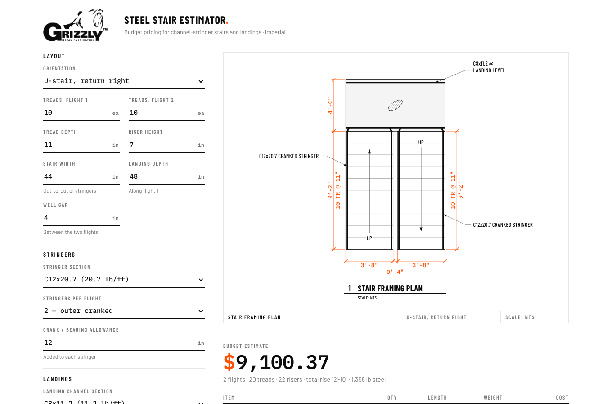

# Steel Stair Estimator

A single-page tool for pricing steel channel stairs. Pick the stair layout, stringer and
landing channel sizes, and the number of treads, and the page draws a **live framing plan**
and works out material and labour cost as you type.



## What it does

- **Layouts**: straight run, straight with mid landing, L-stair (90° turn, left or right),
  U-stair (180° return, left or right). These are modelled on typical stair framing plans.
- **Stringers**: choose any C or MC channel (or enter a custom lb/ft), with 2 outer cranked
  stringers or 4 (2 cranked + 2 inner).
- **Landings**: choose the channel section, the number of channels per landing and the
  number of landings. The channel length matches the landing width automatically, or you
  can set it yourself.
- **Material**: $/tread, $/lb of channel, and a % allowance for connections and misc steel.
- **Labour**: total shop hours × shop rate, plus an optional markup.
- **Live plan view** in drawing style: stringers, landing channels, tread lines, UP arrows
  and dimension strings, all redrawn on every change.
- Your last inputs and rates are remembered in the browser (localStorage).

> The rates that ship with the page are **example values**. Replace them with your own.
> This is a budget estimating tool, not an engineered design. Member sizes must be
> confirmed by the engineer of record.

## Running it

There is no build step and nothing to install. Use either:

- **Open the file**: double-click `index.html`.
- **Local server** (optional):
  ```bash
  python3 -m http.server 8000
  ```
  Then browse to http://localhost:8000.

## Deploying to GitHub Pages

1. Push this repository to GitHub.
2. Go to **Settings → Pages → Build and deployment**, set *Source* to **Deploy from a
   branch**, then pick `main` and `/ (root)`.
3. The site appears at `https://<your-user-or-org>.github.io/<repo-name>/`.

## Tests

The cost maths in `js/calc.js` has unit tests that use Node's built-in test runner
(Node 18 or later, no packages needed):

```bash
npm test
```

## Files

| Path | What it is |
|---|---|
| `index.html` | Page markup: inputs, plan view, estimate table |
| `css/styles.css` | Colours (light and dark), layout, print styles. Matches the Steel Size Rolodex look |
| `assets/grizzly-logo.png` | Logo, shown through a CSS mask |
| `js/calc.js` | Channel section table, default values, all cost maths. **Edit rates and sizes here** |
| `js/plan.js` | Draws the plan view (SVG) |
| `js/app.js` | Connects the inputs to the maths and the drawing |
| `tests/calc.test.js` | Unit tests for `calc.js` |
| `docs/ARCHITECTURE.md` | How the pieces fit together, plus how to add sections, cost lines or layouts |

Every file is commented for hand editing. Start with the header comment at the top of each
file, and see [docs/ARCHITECTURE.md](docs/ARCHITECTURE.md) for common changes.
